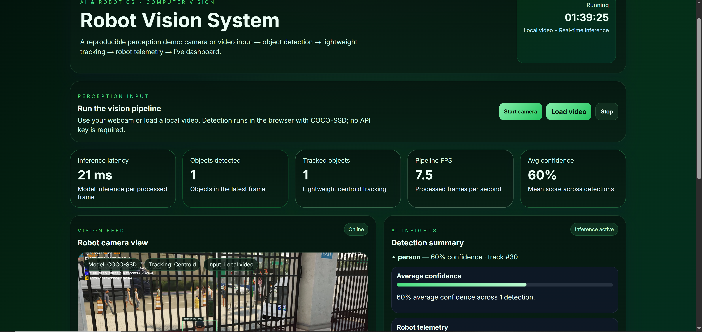

# Robot Vision System


A browser-based computer vision and robotics perception demo that turns camera/video input into **real object detections, lightweight tracking, performance metrics, and robot telemetry** in a live dashboard — with an optional **AI Bridge** to [aws-bedrock-robotics-demo](https://github.com/Lazaro549/aws-bedrock-robotics-demo) for LLM robot decisions.

> **Portfolio goal:** demonstrate an end-to-end perception workflow. Computer vision inference is real; robot telemetry is simulated; robot *commands* can come from a local Python bridge (mock reasoner or Amazon Bedrock Claude).

## What it demonstrates

- Real-time webcam input through the browser
- Local video-file input for reproducible demos
- Object detection with **TensorFlow.js + COCO-SSD**
- Confidence thresholding and per-frame detections
- Lightweight centroid-based object tracking across frames
- Inference latency / FPS / confidence metrics
- Simulated robot battery, odometry, and network telemetry
- **AI Bridge** — stream scenes to `aws-bedrock-robotics-demo` and display robot commands live

## Architecture

```
[ Webcam / Local Video ]
         ↓
   COCO-SSD (browser)
         ↓
   Centroid tracking + metrics
         ↓
   Optional POST /scene  ──→  aws-bedrock-robotics-demo bridge
                                    ↓
                              Mock / Bedrock Claude
                                    ↓
                              Robot command + reasoning
                                    ↓
                              Shown in dashboard
```

### Real vs simulated components

| Component | Status |
|---|---|
| Webcam / local video input | **Real** |
| Object detection | **Real** |
| Detection confidence | **Real model output** |
| Centroid tracking | **Real browser-side algorithm** |
| Latency / FPS measurement | **Real** |
| Robot battery / odometry | Simulated |
| Robot commands (with bridge) | From Python bridge (mock or Bedrock) |
| Physical robot | Not required |

## Run locally

```bash
python -m http.server 8000
# open http://127.0.0.1:8000/
```

Or with Node: `npx serve .`

## Connect the AI Bridge

1. In another terminal, start the robotics demo bridge:

```bash
cd aws-bedrock-robotics-demo
source .venv/bin/activate
python -m src.bridge_server --mode mock --port 8787
# or: python -m src.bridge_server --mode bedrock --port 8787
```

2. Open the dashboard, enable **AI Bridge**, keep the URL `http://127.0.0.1:8787/scene`.
3. Start camera or load a video.
4. Detections are posted ~every 1.5s; the **AI robot decision** card shows command + reasoning.

Integration details: [aws-bedrock-robotics-demo/docs/integration-dashboard.md](https://github.com/Lazaro549/aws-bedrock-robotics-demo/blob/main/docs/integration-dashboard.md)

## How to test the pipeline

1. Start the local server and open the dashboard.
2. Click **Start camera** or **Load video**.
3. Verify bounding boxes, latency, FPS, and detection list update.
4. (Optional) Enable AI Bridge with the bridge server running and confirm decisions appear.
5. Use **Capture snapshot** / **Stop** as needed.

## Testing

```bash
npm install
npm test
```

CI: `.github/workflows/test.yml`

## Related project

- [aws-bedrock-robotics-demo](https://github.com/Lazaro549/aws-bedrock-robotics-demo) — Vision → Bedrock reasoning → robot command pipeline + HTTP bridge

## License

Portfolio and learning project.
