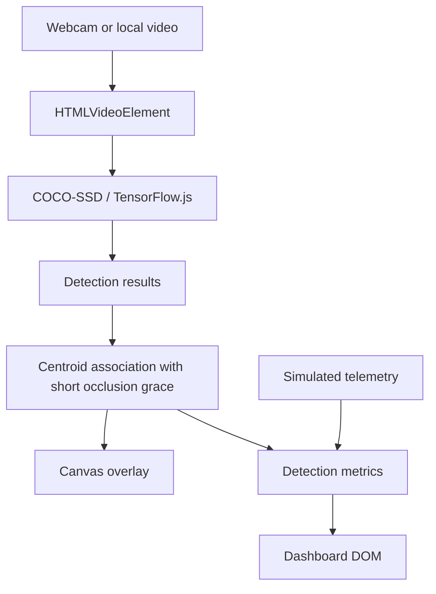
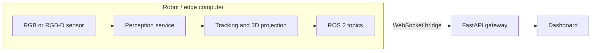

# Architecture and engineering roadmap

## Current implementation (this branch)

The application remains a static browser application. TensorFlow.js + COCO-SSD performs inference in the browser; the dashboard renders detections and simulated robot telemetry. No ROS 2 node, physical robot, backend inference service, or real odometry source is introduced by this change.

### Runtime flow



### Responsibilities

| Component | Responsibility | Current status |
|---|---|---|
| Input adapter | Acquire webcam or local video | Browser implementation |
| Detection engine | Run object detection | COCO-SSD in browser |
| Tracker | Associate detections and retain IDs briefly | Lightweight centroid tracker |
| Renderer | Draw boxes and labels | Canvas 2D |
| Telemetry | Battery, odometry, network | Simulated |
| UI | Metrics, controls, event log | DOM |

## Changes in this hardening branch

- Dynamic log and detection content is rendered with DOM nodes and `textContent`, not HTML string interpolation.
- Webcam startup failures stop acquired media tracks.
- Local video input is MIME-checked, playback/decode errors are handled, and object URLs are revoked on replacement/stop.
- A pipeline generation token prevents late inference or delayed media acquisition from reviving a stopped pipeline.
- Centroid association uses globally sorted candidate/track distances and retains unmatched tracks for a configurable number of processed frames (default: 5).
- Tests cover temporary occlusion, track expiry, and class separation.

## Proposed next architecture (not implemented here)

Keep the browser dashboard as a visualization client, and introduce explicit transport boundaries before connecting a robot:



Suggested message contracts:
- `/perception/detections`: timestamp, frame_id, class, confidence, bounding box.
- `/perception/tracks`: timestamp, frame_id, track_id, class, position.
- `/robot/telemetry`: timestamp, battery, odometry, network state.

Use calibrated RGB-D intrinsics and TF transforms before publishing metric 3D positions. Keep simulated telemetry clearly labelled until a real robot source is connected.

## Recommended repository evolution

```text
src/
  perception/
    DetectionEngine.js
    CocoSsdEngine.js
  tracking/
    CentroidTracker.js
  input/
    CameraSource.js
    VideoFileSource.js
  rendering/
    OverlayRenderer.js
  telemetry/
    TelemetryProvider.js
  ui/
    dashboard.js
tests/
  tracking/
  perception/
  integration/
robot/
  ros2_ws/src/vision_bridge/
docs/
  ARCHITECTURE.md
```

Migrate incrementally: first extract the tracker and detection adapter with contract tests; then add a backend/ROS 2 bridge as a separate deployment target. Do not couple ROS 2 dependencies to the static frontend.
